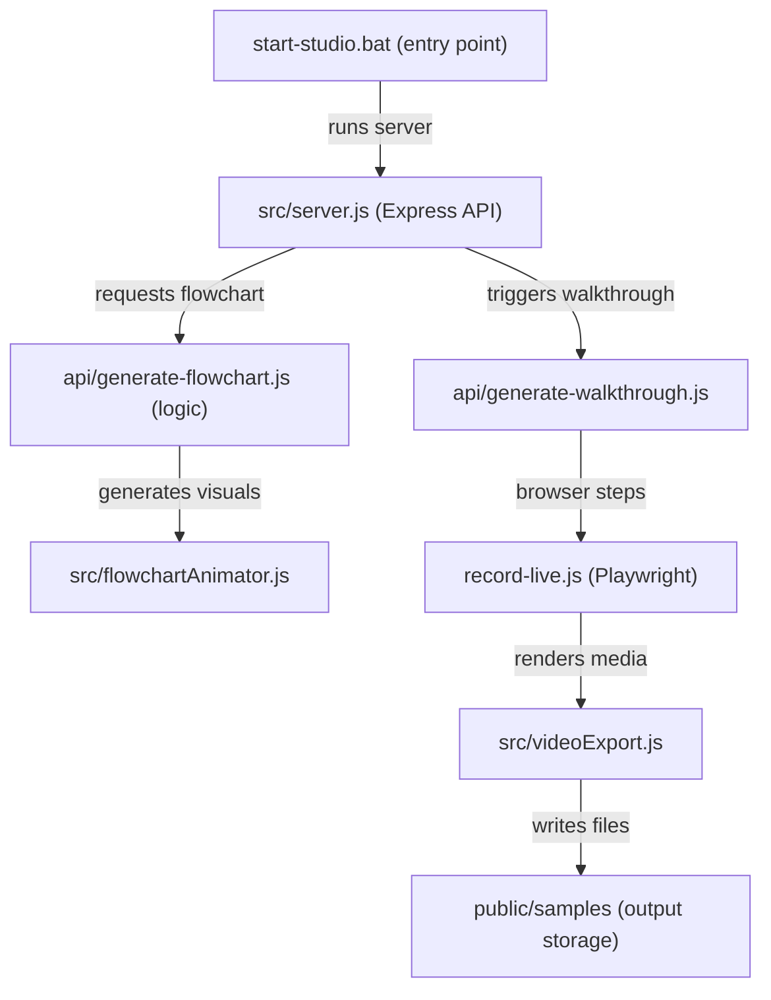

# VisualProof Studio

Automated 15–20 second GIF and screen recording suite for creating browser walkthroughs and animated flowcharts.


<!-- Screenshot: add docs/screenshot.png -->

## Overview

VisualProof Studio enables users to automate the creation of short, visually engaging GIFs and videos. It simplifies browser walkthrough recordings and animated flowchart generation, making it suitable for presentations, LinkedIn posts, or educational material. The project combines browser automation, animation tools, and media encoding to produce polished outputs.

## Features

- Automated browser walkthrough recordings using Playwright (`record-live.js`).
- Animated flowchart generation for diverse configurations (`generate-flowcharts.js`).
- GIF and MP4 media export support (`public/samples` and `src/videoExport.js`).
- URL and DNS validation for safer automation workflows (`src/urlSafety.js`).
- Replayable workflows for recording consistency (`api/plan.js`, `api/generate-walkthrough.js`).
- Fully configurable flowchart designs (e.g., colors, transitions) (`src/flowchartAnimator.js`).
- Works entirely without a database or external web services.

## How It Works



## Tech Stack

- **JavaScript** (CommonJS modules)
- **Express** for API and server functionality
- **Playwright** for browser automation
- **gifenc** and **pngjs** for media encoding

## Getting Started

### Prerequisites

- Node.js (LTS)
- Chromium browser (managed by Playwright)

### Installation

1. Clone the repository:
   ```bash
   git clone https://github.com/EF361/visual-proof-studio.git
   cd visual-proof-studio
   ```
2. Install dependencies:
   ```bash
   npm install
   ```

### Usage

- Start the server:
  ```bash
  npm run start
  ```
- Record a browser walkthrough:
  ```bash
  npm run record
  ```
- Generate flowchart samples:
  ```bash
  npm run samples
  ```

## Project Structure

```
visual-proof-studio/
├── api/
│   ├── generate-flowchart.js
│   ├── generate-walkthrough.js
│   ├── plan.js
├── public/
│   ├── demo/
│   ├── samples/
│   └── style.css
├── src/
│   ├── flowchartAnimator.js
│   ├── gifEncoder.js
│   ├── server.js
│   ├── urlSafety.js
│   ├── videoExport.js
├── record-live.js
├── test-verify.js
├── package.json
```

## Testing

Run the test script to validate functionality:
```bash
npm run test
```

## Roadmap

- [ ] Add Continuous Integration (CI) for automated testing and linting.
- [ ] Implement unit tests for step parsing, timing, and safety validation.
- [ ] Pin Node.js and FFmpeg compatibility ranges.
- [ ] Enhance media processing with stricter resource limits and cleanup routines.

---

Built by [Alicia Goh](https://github.com/EF361)