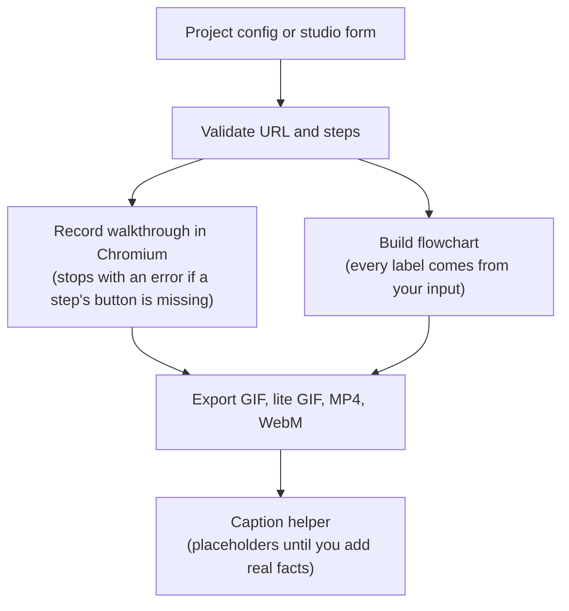

# VisualProof Studio

Record a real walkthrough of your web app and an animated flowchart of how it works, as **GIF and MP4**, ready to attach to a LinkedIn post.

It opens your site in a headless Chromium browser (Playwright), moves a visible cursor, clicks the buttons you name, and shows a short caption for each step.

## How it works



## Tech stack

| Part | Used for |
|---|---|
| Node.js 18+ | Runtime |
| [Playwright](https://playwright.dev) (Chromium) | Opening the site, clicking, screenshots, WebM recording |
| Express | Local studio server (`src/server.js`) |
| gifenc + pngjs | GIF encoding |
| ffmpeg (optional) | MP4 (H.264) export. Without it you still get GIF and WebM |

There is no database, no Docker setup and no CI pipeline in this repo.

## Quick start

```bash
npm install
npx playwright install chromium   # first time only
npm start                         # studio at http://localhost:3000
```

Other scripts:

```bash
npm run record                    # record using visualproof.config.js
npm run record -- my-app.config.js
npm run samples                   # rebuild the sample flowcharts in public/samples
npm test                          # end-to-end checks against the built-in demo
```

On Windows you can also double-click `run.bat`.

## Record a walkthrough from a config file

Copy `visualproof.config.js` for each project and edit it:

```js
module.exports = {
  name: 'entropass',                    // output file prefix
  url: 'https://your-app.vercel.app',
  formats: ['4x5', '1x1'],              // 1x1, 4x5, 1.91x1, standard
  output: ['mp4', 'gif', 'gif-lite'],   // gif, gif-lite, webm, mp4
  badgePosition: 'top',                 // top or bottom
  // duration: 15,                      // optional: fit to N seconds. Leave out for real timing
  steps: [
    { caption: 'Strength estimate', point: { text: /≈ \d+ bits/ } },
    { caption: 'Passphrase mode', click: { role: 'button', name: 'Passphrase' } },
    { caption: 'Copied to clipboard', click: { role: 'button', name: 'Copy to clipboard' } },
    { caption: 'Mobile view', viewport: 'mobile', click: { role: 'button', name: 'Generate' } }
  ]
};
```

Each step has a `caption` and at most one of `click` or `point`. The target is one of:

| Target | Example |
|---|---|
| Role and accessible name (most reliable) | `{ role: 'button', name: 'Generate' }` |
| Visible text (string or regex) | `{ text: 'Copy' }` |
| CSS selector | `{ selector: '#qr-btn' }` |

Optional per step: `viewport: 'mobile' | 'desktop'`, `scroll: 300` (pixels), `hold: 1800` (ms to stay on the result).

**Fails loudly.** If a target is not found within 5 seconds, the run stops with a message like
`Step 3 ("Passphrase mode"): button 'Passphrase' not found` and no partial files are written.
Config mistakes are all listed at once before the browser starts.

Outputs go to `public/outputs/` (git-ignored). The lite GIF is 60% size with 64 colours and half the frames, usually about 4–5× smaller. The MP4 is built from the same frames as the GIF, so the mobile view stays centred and the timing matches.

## Studio (browser UI)

`npm start`, then open http://localhost:3000.

- **Recording Steps** box: one step per line, for example
  ```text
  Click "Generate"
  Point at "Strength"
  Passphrase mode | Click "Passphrase"
  Mobile: Click `#mobile-generate-btn`
  ```
  Text in quotes is the button text, backticks hold a CSS selector, and text before `|` becomes the caption. Leave it empty on `/demo` to use the built-in demo steps. This is a rule-based **step planner**, not AI: lines without a target are rejected with a message instead of being guessed.
- **Flowchart:** 3–8 stages in your order, an optional title and an optional footer note. `Label (sub label)` adds a small second line. Nothing else is added: no invented servers, protocols or latency numbers.
- **Captions:** the templates contain `[placeholders]`. The Post to LinkedIn button will not open until every `[bracketed]` part is replaced or deleted. See `TEMPLATES.md`.

## Deploying to Vercel

Vercel cannot run Playwright, so the deployed site is a **demo**: the `api/` functions return the pre-recorded samples in `public/samples/`, and the page shows a "Demo mode" note. Record your own app by running the studio locally.

## Security

- The studio server listens on `127.0.0.1` only by default. Set `HOST=0.0.0.0` only on a network you trust.
- Target URLs must be `http`/`https`, without a username or password, and must not resolve to a private, loopback, link-local or similar address (checked after DNS lookup). The studio's own `/demo` is the one exception.
- While recording, every request the browser makes (redirects, images, scripts) is checked the same way, so a public page cannot redirect the recorder to an internal address.
- The CLI (`npm run record`) runs only on your machine with your own config, so it can record `localhost` apps.

## Project structure

```text
src/
  server.js            Express studio server and API
  walkthrough.js       Recording engine (config check, steps, GIF/MP4 export)
  planner.js           Step planner: text lines -> steps
  flowchartAnimator.js Animated flowchart (3-8 stages)
  urlSafety.js         SSRF checks
  videoExport.js       MP4 export via ffmpeg
  gifEncoder.js        GIF encoder (full and lite)
record-live.js         CLI: record from a config file
visualproof.config.js  Example config (built-in demo)
public/                Studio UI, demo app (public/demo), samples
api/                   Vercel demo functions (return samples)
TEMPLATES.md           Caption playbook with placeholders
```
